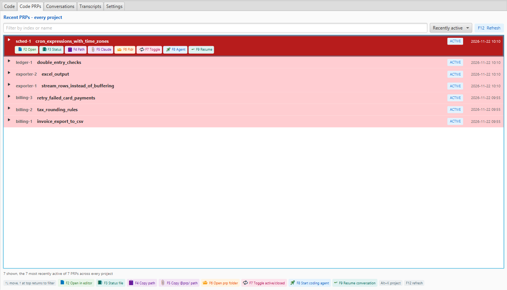

# proj

proj is a command-line tool and a keyboard-first window that keeps an index of every repository on your machine, and manages PRPs (project requirement prompts): the requirement documents you give a coding agent, one file per requirement, in a `prp/` folder of the project.



The screenshots show invented projects. They are made by `ScreenshotHarness`, which opens the real window over a made-up code folder in a scratch home.

## Install

Windows, in a Command Prompt or PowerShell (curl.exe ships with Windows 10 and 11):

```
curl.exe -fLo proj.exe https://github.com/littlejlib/proj/releases/latest/download/proj.exe
.\proj.exe install
```

macOS, in Terminal (`uname -m` picks Apple silicon or Intel):

```
curl -fLo /tmp/proj https://github.com/littlejlib/proj/releases/latest/download/proj-macos-$(uname -m) && chmod +x /tmp/proj && /tmp/proj install
```

No administrator rights, and nothing to install first: on first run proj fetches its jar (about 90 MB) from the release, checked against the SHA-256 the launcher carries, and a Java runtime if there is none. On Windows it goes to `%LOCALAPPDATA%\Programs\proj` and onto your PATH; on a Mac `proj.app` goes to `~/Applications` and the `proj` command to `~/.local/bin`. Open a new terminal afterwards and run `proj prp guide`.

The first run writes a template `Settings.toml` in `~/littlejlib/proj` and stops: set `codebase.primary` to the folder that holds your repositories (or run `proj settings`, a window that edits the same file), then run proj again.

Update with `proj update`, remove with `proj uninstall`. Your settings, index and PRPs stay.

## What it does

- `proj o` (or `proj open`) opens the picker: every repository under your code folders, with its Maven coordinates, git state, Maven Central status and dependencies. Everything is on the keyboard; Down enters the list, Right opens the project's PRPs, F1 opens a shell there, and in the PRP list F8 starts a coding agent.
- `proj list`, `find`, `info`, `deps`, `where`, `impact`, `blocked` answer the same questions without a window (`--json` for scripts): which project provides this artifact, what breaks if this one changes, which projects cannot publish until a local dependency is released.
- `proj prp new "<name>"` creates the next numbered PRP in a project, `proj prp list` and `proj prp status <n>` read them, `proj prp recall <n>` tells an agent where a PRP stands, `proj prp agent <n>` opens a terminal at the project and starts a coding agent on it.
- `proj prp guide` prints the PRP convention. Every PRP file starts with a front matter whose `conventions` line tells an agent to run it first, so the agent works the same way in every project.
- `proj cct` indexes your Claude Code conversations so you can search them, and `proj prp logs` ties a conversation to its PRP.

More in [the PRP convention](https://littlejlib.github.io/proj/) and in `proj --help`. A longer example of one instruction split into several PRPs is in [docs/worked-example.md](docs/worked-example.md).

## What it does not do

It does not edit your code or run your builds. The index is a local database in `~/littlejlib/proj`. proj reaches the network for the Maven Central status check, for `git clone` through `proj clone`, for `proj update` and the download of its own jar, and, only if you add a provider to `ai.toml` (off until you do), to ask an AI service for short names for a new PRP. It does not start a coding agent without you asking: `proj prp agent` opens a visible terminal, and a launch that can run without permission prompts is only made when you say so.

## Status

Version 0.2.0 is the first public release. Windows is what its author uses every day. On macOS the release builds and installs on a fresh profile on both Apple silicon and Intel (CI runs it on every release build), and on Apple silicon `scan`, `list`, `info`, `where`, `impact`, `prp new|list`, `cct index|find`, the daemon, `prp agent --print` and the tab script have been run by hand. Not tried on a Mac yet: the picker window, a real `prp agent` launch, the global summon key, `clone`, `ide` and `prp logs`. Intel Macs are built but not run by hand.

macOS builds are signed ad hoc, not by an Apple developer. Downloaded with curl, as above, they open as they are; downloaded with a browser, macOS asks once (System Settings, Privacy and Security, Open Anyway).

## Build

JDK 25 and Maven; everything builds from Maven Central alone, and `.github/workflows/release.yml` proves it from an empty repository on every release build.

```
cd proj
mvn package
java -jar target/littlejlib-proj-0.2.0.jar --help
```

The launchers (`proj.exe`, `proj-macos-arm64`, `proj-macos-x86_64`) are [jr](https://github.com/jarrunner/jr) with their config baked in, built by jr-maven-plugin in the `jrexe` profile (`mvn -Djrexe -Djr.source=url package` for a release launcher). JavaFX carries its natives per platform, so a Mac build is made on a Mac, with `-Djr.platforms=macos -Djr.macosArchitecture=arm64` or `x86_64`; the workflow does exactly that.

## Credit

The PRP convention follows work by Cole Medin: see his video [Project Requirement Prompts](https://www.youtube.com/watch?v=Mk87sFlUG28). This is an independent implementation that differs from his in places, and he neither endorses nor is responsible for it.
