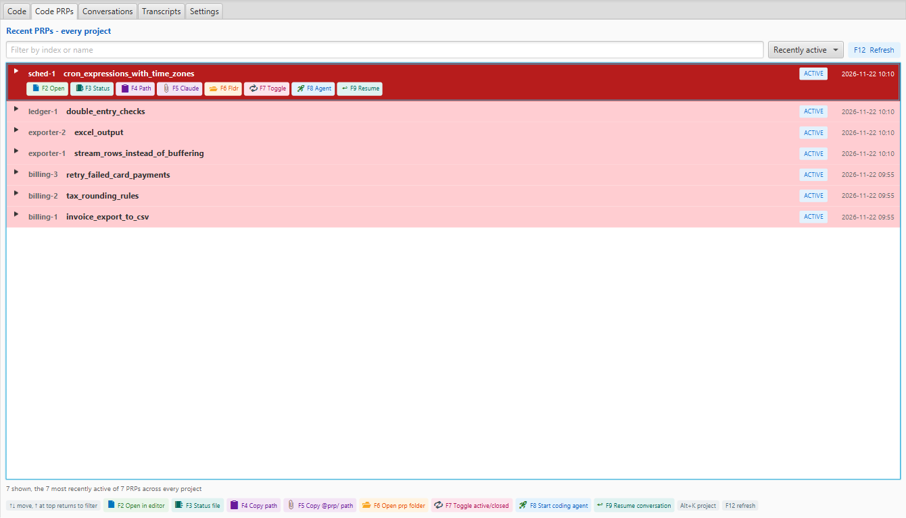

# proj

proj keeps an index of every repository on your machine and manages PRPs: project requirement prompts, the requirement documents you give a coding agent, one file per requirement, in the `prp/` folder of a project. It is a command-line tool plus a keyboard-first window, for Windows and macOS.



## If a PRP file sent you here

A PRP file begins with a block of lines between two `---` marks, its front matter. One line of it reads:

> conventions: before anything else, run `proj prp guide` and follow what it prints. It is the current PRP (project requirements prompt) convention and is managed by the proj tool. If proj is not installed and not found in path refer https://littlejlib.github.io/proj/ for download and install.

That line is for the coding agent (or for you). It means: run `proj prp guide`, a command of this tool that prints the current rules for working on a PRP: how PRPs are numbered and named, which files belong to one PRP, how to record progress with `proj prp note`, how to keep a project's work items with `proj prp plan`, and what to do when the work ends. The rules come from the tool, not from the PRP file, so they are the same in every project and change in one place. If `proj` is not found on your machine, install it below, open a new terminal and run `proj prp guide`.

The other lines of the front matter name the PRP: `prp_number` and `prp_number_b34str` (its number, counted 0001 to 000Z and on), `prp_name`, `prp_short_name` and `prp_3_letter_name` (what a terminal tab and a ticket like `billing-7` are called), and `prp_uuid`, which stays the same if the file is renamed. Three more keys follow: `prp_status` (new, in_progress, in_review, on_hold, blocked, closed or cancelled), `created_utc` and `last_worked_on_utc`. A PRP is closed by setting its `prp_status`, never by renaming the file. proj writes this block itself; the requirement under it is yours.

## Download and install

No administrator rights, and nothing to install first. Version 0.2.0 is the first public release.

Windows 10 or 11, in a Command Prompt or PowerShell (curl.exe ships with Windows):

```
curl.exe -fLo proj.exe https://github.com/littlejlib/proj/releases/latest/download/proj.exe
.\proj.exe install
```

macOS 13 or later, in Terminal (one line; `uname -m` picks Apple silicon or Intel):

```
curl -fLo /tmp/proj https://github.com/littlejlib/proj/releases/latest/download/proj-macos-$(uname -m) && chmod +x /tmp/proj && /tmp/proj install
```

On Windows proj goes to `%LOCALAPPDATA%\Programs\proj` and onto your PATH. On a Mac `proj.app` goes to `~/Applications` and the `proj` command to `~/.local/bin`; the program is signed ad hoc, not by an Apple developer, so it opens as it is when downloaded with curl, and a browser download makes macOS ask once (System Settings, Privacy and Security, Open Anyway). On the first run proj fetches its jar (about 90 MB) from the release, checked against the SHA-256 the launcher carries, and a Java runtime if none is found.

Open a new terminal and run:

```
proj prp guide
```

The first time you run any other command, proj writes a template `Settings.toml` in `~/littlejlib/proj` and stops. Set `codebase.primary` to the folder that holds your repositories, or run `proj settings` for a window that edits the same file, then run proj again. `proj o` opens the picker; `proj --help` lists everything.

All downloads, with their SHA-256 sums, are on the [releases page](https://github.com/littlejlib/proj/releases).

## Update and remove

`proj update` replaces the program with the newest release after checking its SHA-256, and stops the background process first. `proj uninstall` removes what `proj install` put in place; your settings, index and PRPs stay in `~/littlejlib/proj` and in the `prp/` folders of your projects.

## What is tried where

Windows is what the author uses every day. On macOS the release builds and installs on a fresh profile on Apple silicon and Intel, and the main commands have been run by hand on Apple silicon. Not tried on a Mac yet: the picker window, starting a coding agent from a PRP, the global summon key, `proj clone`, `proj ide` and `proj prp logs`.

## Build from source

JDK 25 and Maven; everything comes from Maven Central.

```
git clone https://github.com/littlejlib/proj
cd proj/proj
mvn package
java -jar target/littlejlib-proj-0.2.0.jar --help
```

The source, the issue tracker and the longer README are at [github.com/littlejlib/proj](https://github.com/littlejlib/proj).

The PRP convention follows work by Cole Medin ([Project Requirement Prompts](https://www.youtube.com/watch?v=Mk87sFlUG28)); this is an independent implementation.
